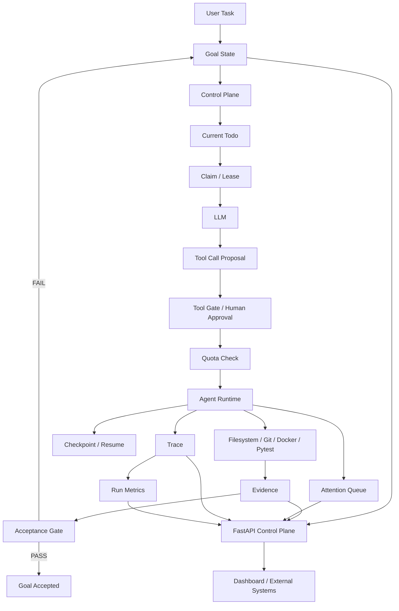

# LoopCoder

> Long-Horizon Coding Agent Runtime & Control Plane

LoopCoder 是一个面向长程代码维护任务的 **Coding Agent Runtime 与 Control Plane**。

它并不试图训练一个“更聪明的代码模型”，而是解决另一个问题：

> 当 LLM 需要连续完成代码阅读、修改、测试、失败恢复和最终验收时，谁来管理它的执行过程？

基础 Coding Agent 通常可以完成 Tool Calling，但在长程任务中仍然容易出现任务状态不明确、工具调用缺少边界、失败后无法恢复、模型提前声明完成、测试结果与真实任务完成状态混淆等问题。

LoopCoder 将这些能力从 Prompt 中移入 Runtime，通过显式的：

- Goal / Todo State
- Control Tick
- Claim / Lease
- Tool Gate / Human Approval
- Quota
- Protected Paths
- Evidence
- Acceptance Gate
- Checkpoint / Resume
- Attention Queue
- Trace / Run Metrics
- FastAPI Control Plane

对 Agent 的执行过程进行管理。

> **Completion is evidence-driven, not model-claimed.**

---

# 1. Why LoopCoder?

一个最基础的 Coding Agent Loop 通常是：

```text
User Task
    ↓
LLM
    ↓
Tool Call
    ↓
Tool Result
    ↓
LLM
    ↓
...
```

这种方式可以运行，但随着任务变长，会逐渐暴露出一些工程问题。

例如：

- 模型可能只通过自然语言声称“任务已经完成”
- 没有明确的任务阶段和长期状态
- 不同阶段可以调用什么 Tool 缺少约束
- Agent 可能无限循环调用 LLM / Tool
- 写文件成功不代表业务逻辑正确
- 测试失败后缺少明确的恢复路径
- 进程中断后任务可能需要从头开始
- 多 Worker 场景缺少任务所有权
- 缺少可审计的执行历史
- 人无法快速知道 Agent 当前卡在哪里

LoopCoder 的设计目标不是：

```text
让LLM本身更聪明
```

而是：

```text
让LLM驱动的执行过程
更加可控、可恢复、可验证、可审计
```

---

# 2. Core Architecture



---

# 3. Core Idea

LoopCoder 中最重要的职责划分是：

```text
LLM
= 提出它想做什么

Control Plane
= 判断现在应该做什么、允许做什么

Runtime
= 真正执行动作

Evidence
= 记录客观结果

Acceptance Gate
= 判断任务是否真的完成
```

因此：

```text
LLM says "Done"
```

不等于：

```text
Runtime Accepted
```

---

# 4. Runtime Lifecycle

一次完整 Coding Task 的主要执行流程：

```text
User Task
   ↓
Goal State
   ↓
Inspect Repository
   ↓
Modify Code
   ↓
Review Git Diff
   ↓
Verify Project
   ↓
Evidence Gate
   ↓
Accepted
```

LoopCoder 当前将任务拆分为四个主要 Todo：

```text
Inspect Repository
Modify Code
Review Git Diff
Verify Project
```

任务进度不是通过 Prompt 中的描述维护，而是保存在持久化的 Goal State 中。

---

# 5. Control Tick

Agent Runtime 不是一个无限自由循环，而是由一个个 **Control Tick** 驱动。

每一个 Tick 大致执行：

```text
1. 读取Goal State
2. 找出当前Todo
3. 获取 / 续租Lease
4. 确定允许使用的Tools
5. 构造Control Context
6. 调用LLM
7. 接收Tool Call
8. Tool Gate检查
9. Human Approval检查
10. Quota检查
11. 执行Tool
12. 生成Evidence
13. 更新Todo State
14. 保存Checkpoint
15. 写入Trace
```

核心思想：

> LLM proposes, Control Plane decides, Runtime executes.

---

# 6. Goal & Todo State

LoopCoder 使用持久化 Goal State 描述长程任务当前进度。

典型状态：

```text
Goal
├── Inspect Repository   DONE
├── Modify Code          DONE
├── Review Git Diff      DONE
└── Verify Project       RUNNING
```

Goal 状态包括：

```text
RUNNING
BLOCKED
DONE
FAILED
```

Todo 状态包括：

```text
TODO
RUNNING
BLOCKED
DONE
```

这使得：

```text
Step数量
```

和：

```text
真实任务进度
```

不再被混为一谈。

---

# 7. Claim / Lease

LoopCoder 为 Todo 引入了 Claim / Lease 机制。

Worker 在执行任务前需要持有对应 Todo 的 Lease。

Lease 用于描述：

- 当前 Todo 被哪个 Worker 持有
- Lease ID
- Lease 过期时间
- 是否允许重新 Claim
- Worker 崩溃后是否允许其他 Worker 接管

当前 V1 主要用于建立长程 Agent Runtime 的任务所有权模型。

需要注意：

当前状态主要通过本地 JSON 文件持久化，因此还不提供真正的多进程事务一致性。

如果扩展为生产系统，可以进一步使用：

```text
SQLite Transaction
PostgreSQL
Redis
```

实现并发 Claim。

---

# 8. Tool Gate

不同 Todo 只允许使用特定 Tool。

例如：

```text
Inspect Repository
→ list_files
→ read_file
```

```text
Modify Code
→ read_file
→ list_files
→ write_file
→ replace_text
```

```text
Review Git Diff
→ git_diff
```

```text
Verify Project
→ verify_project
```

即使 LLM 提出了一个 Tool Call，只要当前 Control Plane 不允许：

```text
Tool Call
    ↓
Control Plane
    ↓
DENIED
```

Tool 也不会真正执行。

---

# 9. Human Approval

文件修改等高风险动作可进入 Human Approval Gate。

例如：

```text
replace_text
write_file
```

可以要求人工确认后才真正执行。

Benchmark / Eval 模式下支持自动批准，用于无人值守测试。

Human Approval 与权限控制并不是同一个概念：

```text
Permission
= 这个类型的操作原则上是否允许

Approval
= 这一次具体操作是否批准
```

---

# 10. Protected Paths

LoopCoder 支持对指定路径进行保护。

例如：

```text
tests/
```

可以被标记为 Protected Path。

即使 Agent 尝试修改：

```text
tests/test_xxx.py
```

Runtime 也可以阻止该操作。

Acceptance Gate 还会再次检查最终变更文件，实现：

> Runtime Protection + Acceptance Recheck

的双重保护。

---

# 11. Quota System

为避免 Agent 无限循环，LoopCoder 提供运行预算。

当前支持：

```text
ticks
llm_calls
tool_calls
verify_calls
runtime_seconds
```

例如：

```text
ticks:           5 / 20
llm_calls:       5 / 20
tool_calls:      7 / 50
verify_calls:    1 / 6
runtime_seconds: 104 / 900
```

当某项预算耗尽时：

```text
Quota Exhausted
       ↓
Todo BLOCKED
       ↓
Goal BLOCKED
       ↓
Attention Queue
```

Quota 状态同时参与 Checkpoint 持久化，避免进程重启后通过“清零预算”绕过限制。

---

# 12. Evidence

LoopCoder 区分：

```text
Tool Success
```

与：

```text
Task Success
```

例如：

```python
{
    "success": True
}
```

只表示：

> Tool 本身成功执行。

例如：

```text
write_file success=True
```

只能证明文件成功写入。

它不能证明：

- 修改正确
- 测试通过
- 业务规则满足
- 没有修改禁止文件

因此 Runtime 会进一步生成 Evidence。

主要 Evidence 包括：

```text
INSPECTION
MODIFICATION
GIT_DIFF
VERIFICATION
```

典型执行结果：

```text
[PASS] INSPECTION
[PASS] MODIFICATION
[PASS] GIT_DIFF
[PASS] VERIFICATION
```

---

# 13. Verification

项目验证运行在 Docker Sandbox 中。

当前主要使用：

```text
python -m pytest -q
```

Verification 状态包括：

```text
PASS
TEST_FAILED
INFRA_ERROR
POLICY_DENIED
```

这些状态具有不同语义。

## PASS

```text
测试正常执行
+
returncode == 0
```

Todo 可以完成。

## TEST_FAILED

测试确实运行，但业务代码未通过测试。

Runtime 会重新打开修改流程：

```text
Verify Failed
    ↓
Modify
    ↓
Review
    ↓
Verify Again
```

## INFRA_ERROR

例如：

```text
Docker没有启动
Sandbox异常
```

这不属于代码逻辑错误，因此不会简单当作测试失败处理。

## POLICY_DENIED

Verifier 请求违反执行策略。

例如运行了不允许的命令。

---

# 14. Evidence-driven Acceptance

LoopCoder 不接受：

```text
LLM: "任务已经完成"
```

作为完成依据。

最终 Acceptance 需要满足多个客观条件。

例如：

```text
All Todos DONE
+
Workspace存在真实变更
+
Git Diff Evidence
+
Verification PASS
+
没有Open Attention
```

最终才会：

```text
Goal Accepted = True
```

并生成 Accepted Writeback。

核心原则：

> **Completion is evidence-driven, not model-claimed.**

---

# 15. Checkpoint / Resume

LoopCoder 会在完整 Agent Step 后保存 Checkpoint。

Checkpoint 用于恢复执行状态。

主要包含：

```text
user_task
next_tick
context_state
worker_state
quota_state
```

Checkpoint 只在完整：

```text
AIMessage
+
对应ToolMessages
```

之后保存。

这样可以避免恢复后出现 Tool Call Protocol 不完整的问题。

Checkpoint 与 Goal State 的区别：

```text
Checkpoint
= 执行恢复状态

Goal State
= 任务语义进度
```

---

# 16. Context Management

长程 Agent 不能无限向 LLM 发送全部历史。

LoopCoder 的 Context Manager 将历史分为：

```text
history_summary
+
recent_steps
```

旧 Step 可以压缩，只保留最近几个完整 Agent Step。

这里强调：

```text
完整Agent Step
=
AIMessage
+
对应的所有ToolMessages
```

不能随意按单条 Message 裁剪，否则可能破坏：

```text
tool_call_id
```

与 ToolMessage 的对应关系。

---

# 17. Attention Queue

Trace 和 Attention 解决的是两个不同问题。

```text
Trace
= 过去发生了什么

Attention
= 现在还有什么问题需要处理
```

例如：

```text
LEASE_CONFLICT
HUMAN_APPROVAL_DENIED
LEASE_LOST
QUOTA_EXHAUSTED
INFRA_ERROR
```

都可以进入 Attention Queue。

这样外部系统无需扫描全部日志，就能快速知道 Agent 当前是否需要人工介入。

---

# 18. Workspace Isolation

真实代码任务不会直接修改 Source Repository。

LoopCoder 会为每次运行创建独立 Workspace：

```text
Source Repo
    ↓
prepare_run()
    ↓
runs/<run_id>/workspace
    ↓
Agent modifies this copy
```

因此：

```text
Source Repository
```

保持不变。

Agent 的文件修改、Git Diff 和 Verification 都发生在独立运行目录中。

---

# 19. Docker Sandbox

代码验证通过 Docker Sandbox 隔离执行。

当前 Sandbox 主要用于：

```text
Pytest Verification
```

运行时可以限制：

```text
network
CPU
memory
workspace mount
```

Verification Workspace 使用只读挂载策略，避免测试过程反向修改代码。

---

# 20. Trace

LoopCoder 使用 JSONL 记录结构化运行轨迹。

典型 Event：

```text
control_decision
llm_response
approval_decision
tool_result
```

每条记录包含：

```text
time
event_type
data
```

Trace 主要用于：

- Debug
- Audit
- Run History
- Metrics
- Benchmark Analysis

---

# 21. Run Metrics

原始 Trace 可以进一步被聚合成运行指标。

例如：

```text
ticks
llm_calls
tool_calls
verify_calls
verify_failures
approval_requests
approval_denied
tool_usage
duration_seconds
```

例如：

```json
{
  "ticks": 5,
  "llm_calls": 5,
  "tool_calls": 7,
  "verify_calls": 1,
  "verify_failures": 0
}
```

可以理解为：

```text
Trace
= 原始日志

Run Metrics
= 从日志统计得到的运行指标
```

---

# 22. FastAPI Control Plane

LoopCoder 提供一个只读 FastAPI Control Plane。

API 本身不会执行 Agent，而是用于观察 Runtime 的状态。

启动：

```powershell
python -m uvicorn control_api:app --reload --port 8001
```

Swagger：

```text
http://127.0.0.1:8001/docs
```

当前主要接口：

```text
GET /health

GET /control/overview

GET /goals/active

GET /goals/active/todos

GET /quota/current

GET /evidence/current

GET /attention/current

GET /acceptance/current

GET /runs

GET /runs/{run_id}

GET /runs/{run_id}/metrics

GET /dashboard
```

---

# 23. Dashboard API

`/dashboard` 将多个 Control Plane 数据源聚合为一个统一视图。

它主要返回：

```text
system_state
goal
todos
quota
evidence
attention
acceptance
latest_run
latest_run_metrics
```

Dashboard 状态目前归一化为：

```text
IDLE
RUNNING
NEEDS_ATTENTION
COMPLETED
```

例如：

```text
Goal不存在
→ IDLE
```

```text
Goal正常执行
→ RUNNING
```

```text
Goal BLOCKED
或存在Open Attention
→ NEEDS_ATTENTION
```

```text
Goal DONE
→ COMPLETED
```

细粒度 API 仍然被保留，用于问题排查和资源级查询。

因此：

```text
/dashboard
= Summary View
```

而：

```text
/goals/active
/evidence/current
/runs/{run_id}
```

属于：

```text
Detail / Drill-down View
```

---

# 24. Project Structure

```text
loopcoder/
│
├── agent.py
├── control_plane.py
├── goal_state.py
│
├── lease_manager.py
├── quota_manager.py
├── evidence_manager.py
├── acceptance.py
├── attention_queue.py
│
├── context_manager.py
├── checkpoint.py
├── trace.py
├── approval.py
│
├── filesystem_tools.py
├── git_tools.py
├── verification.py
├── sandbox.py
├── protection.py
├── workspace_manager.py
├── runtime_paths.py
├── tools.py
│
├── control_store.py
├── run_metrics.py
├── dashboard_service.py
├── control_api.py
│
├── bare_agent.py
├── benchmark_day76.py
│
├── benchmarks/
│   ├── day76_cases.json
│   └── day76_results/
│
├── real_cases/
│   ├── fastapi_user_api/
│   ├── fastapi_email_normalization/
│   └── account_transfer_api/
│
├── accepted/
├── attention/
├── checkpoints/
├── evidence/
├── goals/
├── runs/
├── traces/
│
├── README.md
├── requirements.txt
├── .env.example
└── .gitignore
```

其中：

```text
accepted/
attention/
checkpoints/
evidence/
goals/
runs/
traces/
```

主要属于 Runtime 运行产生的数据目录。

---

# 25. Realistic Evaluation Cases

当前 Benchmark 使用 3 个小型代码维护任务。

## Case 1 — Duplicate Email

目标：

```text
同一个email不能重复创建用户
```

要求：

```text
重复email时抛出ValueError
禁止修改tests
最终pytest通过
```

---

## Case 2 — Email Normalization

目标：

```text
实现邮箱规范化
```

要求：

```text
strip()
lower()
create_user存储规范化email
重复email检测忽略大小写
禁止修改tests
pytest通过
```

---

## Case 3 — Account Transfer

目标：

```text
修复账户转账业务逻辑
```

要求：

```text
amount <= 0时报错
余额不足时报错
禁止向同一账户转账
任何失败不得修改账户余额
禁止修改tests
pytest通过
```

---

# 26. Independent Evaluator

Benchmark 不依赖 Agent 自己声明任务完成。

执行完成后，由独立 Evaluator 检查：

```text
Verification Result
Changed Files
Protected Paths
Allowed Changes
Agent Error
```

Benchmark Pass 需要满足：

```text
Verification PASS
+
存在有效修改
+
没有Protected Violation
+
没有Unexpected Change
+
没有Agent Error
```

因此：

> Agent 自己说“完成了”不会直接影响 Benchmark 结果。

---

# 27. Bare Agent vs LoopCoder

为了验证 Control Plane 带来的运行开销与行为差异，项目实现了一个 Bare Agent 作为对照组。

Bare Agent 仍然拥有：

```text
相同LLM
相同Tools
相同Repository
相同Verification
相同Independent Evaluator
```

但不包含 LoopCoder 的完整：

```text
Goal State
Control Tick
Lease
Quota
Evidence Gate
Attention
Acceptance
```

因此 Benchmark 比较的是：

```text
Bare Agent Loop
vs
Runtime + Control Plane
```

而不是故意构造一个很弱的 Baseline。

---

# 28. Benchmark Result

最终 V1 Benchmark：

| Metric | Bare Agent | LoopCoder |
| --- | ---: | ---: |
| Cases | 3 | 3 |
| Passed | 3 | 3 |
| Pass Rate | 100% | 100% |
| Avg LLM Calls | 4.33 | 6.00 |
| Avg Tool Calls | 6.33 | 8.33 |
| Avg Verify Calls | 1.00 | 1.00 |
| Avg Verify Failures | 0.00 | 0.00 |
| Avg Active Time | 9.85 s | 15.86 s |
| Protected Violations | 0 | 0 |
| Unexpected Changes | 0 | 0 |
| Agent Errors | 0 | 0 |

运行：

```powershell
python benchmark_day76.py all
```

正式实验结果保存在：

```text
benchmarks/day76_results/
```

---

# 29. Benchmark Interpretation

当前三个测试任务都属于规模较小的代码维护任务。

在这些任务中：

```text
Bare Agent:
3 / 3 Passed

LoopCoder:
3 / 3 Passed
```

因此当前实验并不能证明：

```text
LoopCoder在简单任务上提高了任务成功率
```

同时 LoopCoder 的：

```text
Avg LLM Calls
Avg Tool Calls
Avg Active Time
```

都高于 Bare Agent。

这是因为 LoopCoder 会额外执行：

```text
Goal State Management
Inspection
Control Tick
Review
Evidence
Acceptance
```

等控制流程。

因此当前实验支持的结论是：

> LoopCoder 在简单任务中引入一定运行开销，用于换取更显式的状态管理、权限边界、Evidence、Recovery 基础设施和可审计执行过程。

LoopCoder 当前并不以：

```text
更少Token
更少LLM调用
更快完成简单任务
```

作为主要目标。

---

# 30. Current Benchmark Limitations

当前 Benchmark 仍然存在以下限制。

## Small Benchmark Size

当前只有：

```text
3个Case
```

无法代表大规模真实软件工程任务。

---

## No Verification Failure in Final Benchmark

最终 3 个 Case 中：

```text
Verify Failures = 0
```

因此当前 Benchmark 并未定量验证：

```text
Verification Failed
→ Modify Again
→ Verify Again
→ Recovery Success
```

虽然 Runtime 已实现相关状态回退逻辑，但目前实验数据不足以证明其 Recovery 效果。

---

## Single-worker V1

当前 Runtime 已建立 Worker / Lease 模型，但主要运行模式仍然是单 Worker。

本地 JSON 持久化也不是为高并发 Worker 设计的。

---

## Git Diff and Untracked Files

普通：

```text
git diff
```

不会显示纯新增的 untracked 文件。

当前 Workspace Change 检测已经通过：

```text
git status
```

识别 untracked 文件，但 Review Evidence 仍可能受到普通 Git Diff 行为限制。

纯新增文件任务可能需要进一步增强 Review 策略。

---

## Local File Persistence

当前：

```text
Goal
Evidence
Checkpoint
Attention
Trace
```

主要使用 JSON / JSONL 文件持久化。

生产系统更适合迁移到数据库和持久化消息系统。

---

# 31. Quick Start

## 31.1 Requirements

建议环境：

```text
Windows 11
Python
Docker Desktop
Git
```

安装 Python 依赖：

```powershell
pip install -r requirements.txt
```

---

## 31.2 Environment Variables

不要将真实 API Key 提交到 Git。

可以创建：

```text
.env
```

并参考：

```text
.env.example
```

例如：

```env
MOONSHOT_API_KEY=your_api_key_here
MOONSHOT_BASE_URL=https://api.moonshot.cn/v1
MODEL_NAME=kimi-k2.7-code
```

---

## 31.3 Docker

Verification 依赖本地 Docker。

运行前确保：

```text
Docker Desktop
```

已启动，并且本地已经存在 LoopCoder 使用的 Sandbox Image。

当前 Sandbox Image：

```text
coding-agent-sandbox
```

可以通过：

```powershell
docker images
```

确认。

---

## 31.4 Run Benchmark

执行全部 Benchmark：

```powershell
python benchmark_day76.py all
```

输出包括：

```text
Bare Agent Result
LoopCoder Result
Benchmark Summary
JSON Result
CSV Result
```

---

## 31.5 Start Control Plane API

运行：

```powershell
python -m uvicorn control_api:app --reload --port 8001
```

然后访问：

```text
http://127.0.0.1:8001/docs
```

测试：

```text
GET /dashboard
```

即可查看当前 LoopCoder Control Plane 的核心状态。

---

# 32. Demo Flow

推荐 Demo 使用一个真实小型 Repo。

完整流程：

```text
Bug Repository
      ↓
LoopCoder
      ↓
Inspect Repository
      ↓
Modify Code
      ↓
Git Diff
      ↓
Docker Pytest
      ↓
Evidence
      ↓
Accepted
      ↓
FastAPI Control Plane
      ↓
Dashboard / Run Metrics
```

Demo 的重点不是：

```text
LLM能不能写一段代码
```

而是展示：

> 一个 Coding Agent 的执行过程如何被 Runtime 管理和验证。

---

# 33. Key Design Decisions

## Tool Success != Task Success

```text
write_file success=True
```

只能证明 Tool 执行成功。

任务是否完成必须由 Evidence 和 Verification 判断。

---

## Trace != Evidence

```text
Trace
= 发生了什么
```

```text
Evidence
= 有什么客观事实可以证明任务是否完成
```

---

## Goal State != Checkpoint

```text
Goal State
= 任务当前做到哪里
```

```text
Checkpoint
= Runtime中断后如何恢复
```

---

## Attention != Trace

```text
Trace
= 历史记录
```

```text
Attention
= 当前尚未解决的问题
```

---

## LLM Proposal != Runtime Permission

```text
LLM
→ 提出Tool Call
```

并不意味着：

```text
Tool一定执行
```

真正执行前仍然要经过：

```text
Control Plane
Gate
Approval
Quota
Protection
```

---

# 34. Technology Stack

```text
Python
LangChain
OpenAI-compatible LLM API
FastAPI
Docker
Git
Pytest
Pydantic
JSON / JSONL
```

---

# 35. What I Learned

这个项目关注的并不是单纯 Prompt Engineering，而是：

```text
Agent Runtime Engineering
```

主要涉及：

- Agent Loop
- Tool Calling
- Runtime State
- Long-horizon Context
- Checkpoint / Resume
- Permission Boundary
- Sandbox
- Evaluation
- Observability
- API Control Plane
- Failure Semantics

项目开发过程中一个非常重要的认识是：

> 一个能调用工具的 LLM，并不自动等于一个可靠的 Agent System。

真正的 Agent 工程需要额外管理：

```text
State
Permission
Budget
Recovery
Evidence
Observability
```

---

# 36. Future Work

当前 V1 不计划继续堆叠功能，后续可能的扩展方向包括：

```text
SQLite / PostgreSQL State Store
True Multi-worker Claim
Failure Injection Benchmark
Larger Real-world Repositories
Streaming Run Events
Web Dashboard
Remote Sandbox
Cost / Token Accounting
Policy Engine
Human Review Workflow
```

这些能力不属于当前 V1 的完成标准。

---

# 37. Project Positioning

LoopCoder 更适合作为：

```text
Agent Runtime
Coding Agent Infrastructure
Agent Control Plane
AI Application Engineering
FDE / Agent Engineering Demo
```

而不是定位成：

```text
Foundation Model
Code Generation Model
IDE Replacement
Production-ready Distributed Agent Platform
```

---

# 38. Summary

LoopCoder 从一个基础：

```text
LLM + Tools
```

逐步扩展为：

```text
LLM
+
Agent Runtime
+
Goal State
+
Control Plane
+
Claim / Lease
+
Gate
+
Quota
+
Sandbox
+
Verification
+
Evidence
+
Acceptance
+
Checkpoint / Resume
+
Attention
+
Trace
+
Metrics
+
FastAPI API
+
Independent Evaluation
```

当前 V1 已完成：

```text
Long-Horizon Coding Agent Runtime
+
Control Plane
+
Independent Benchmark
+
Observability API
```

核心设计原则：

> **The model proposes actions.  
> The runtime controls execution.  
> Evidence decides completion.**